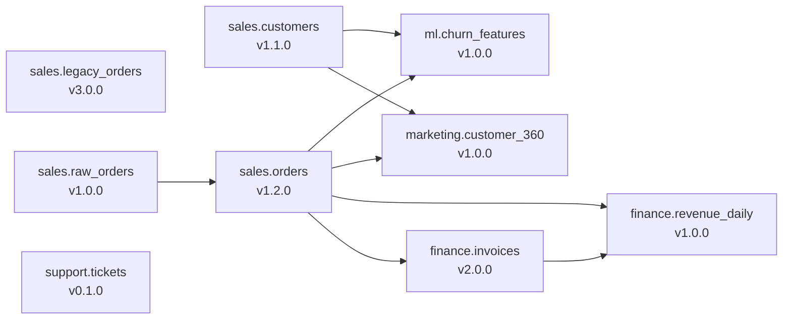

<!-- Generated by `dcr report`. Do not edit; change the contracts and regenerate. -->

# Lineage

Arrows point from a source contract to the contract built from it.

## What each contract reaches

| Contract | Built directly from it | Everything downstream | Consumers affected by a change to the whole contract |
| --- | --- | --- | --- |
| `finance.invoices` | `finance.revenue_daily` | 1 | 4 |
| `finance.revenue_daily` | none | 0 | 2 |
| `marketing.customer_360` | none | 0 | 1 |
| `ml.churn_features` | none | 0 | 1 |
| `sales.customers` | `marketing.customer_360`, `ml.churn_features` | 2 | 4 |
| `sales.legacy_orders` | none | 0 | 0 |
| `sales.orders` | `finance.invoices`, `finance.revenue_daily`, `marketing.customer_360`, `ml.churn_features` | 4 | 9 |
| `sales.raw_orders` | `sales.orders` | 5 | 10 |
| `support.tickets` | none | 0 | 0 |
